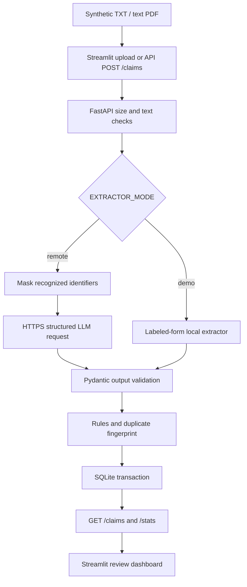

# AI-Powered Medical Claims / Document Assistant

A portfolio project for processing **synthetic** healthcare claim documents. Upload a labeled `.txt` form or text-based `.pdf`; the API extracts claim fields, applies deterministic review rules, stores results in SQLite, and shows the queue and processing statistics in Streamlit. The default mode works offline after dependencies are installed. An optional OpenAI-compatible structured-output adapter demonstrates the versioned prompt and remote LLM integration.

> **Scope:** This is an educational prototype, not a clinical decision, insurance adjudication, or HIPAA-compliant service. Never upload actual patient records or production credentials. No cloud deployment, real-model accuracy, or performance at scale is claimed.

## What is implemented

| Area | Implemented behavior | Limit |
| --- | --- | --- |
| Input | UTF-8 text and extractable PDFs, 2 MiB / 10-page caps | Scanned PDFs need OCR; no image input |
| Extraction | Default regex baseline for labeled synthetic forms; optional HTTPS OpenAI-compatible JSON-schema completion | Baseline does not understand arbitrary prose; remote mode depends on provider schema support |
| Review | Missing fields, nonpositive/high amount, invalid/future date, repeat-field fingerprint | Flags are review hints, not fraud predictions |
| Persistence | SQLite, transactional duplicate check, bounded lists | Single-service demonstration; no production auth, encryption, queue, or horizontal scaling |
| Dashboard | Upload, counts, flag chart, recent claims and details | Latest 500 claims, not all-time analytics |
| Engineering | Docker Compose, pytest, GitHub Actions test/benchmark artifact | CI runs after a repository push; no cloud account/deployment included |

## Architecture and data flow



1. The client submits a document. The API checks its extension and size, then decodes UTF-8 or extracts the PDF text. A PDF with no text returns 422.
2. In **demo** mode, a small baseline reads labels such as `Patient ID:` and `Amount:`. In **remote** mode, recognized name, ID, email, phone, address, and DOB lines are masked before the HTTPS call. The prompt and JSON schema request explicit facts only. The local patient ID is restored from its token after response validation.
3. Pydantic rejects malformed structured output. The rule layer flags missing fields, invalid or future service dates, nonpositive amounts, and amounts above the illustrative 100000 threshold. No medical-code consistency or medical necessity logic is implied.
4. The normalized five-field fingerprint (patient ID, diagnosis, procedure, amount, service date) is SHA-256 hashed. An SQLite `BEGIN IMMEDIATE` transaction checks an earlier fingerprint and saves the result. The second matching document receives `possible_duplicate`. This is a **possible** duplicate because independent identical claims can exist.
5. The API returns the extracted fields and flags. `/claims` and `/stats` power the dashboard; the stats window is the most recent 500 records. The raw uploaded document is not stored, but extracted fields including synthetic patient IDs **are** stored locally.

The remote masking is intentionally limited: labels and email patterns cannot guarantee removal of every identifier in free text. Do not use it as a compliance control for real health data.

## Quick start with Docker Desktop

1. Install Docker Desktop, start it, then open a terminal in this folder.
   Use Docker Compose **2.24 or newer** for the optional `.env` file syntax.
2. Run `docker compose up --build -d`.
3. Open the dashboard at <http://localhost:8501> and API docs at <http://localhost:8000/docs>.
4. Upload `samples/claim_001.txt`, then `samples/claim_002_missing.txt`. Upload the first file again to see the duplicate flag.
5. Run `docker compose down` to stop containers. `docker compose down -v` also deletes the demo database volume.

Docker Compose uses the local **demo** extractor by default. The API and dashboard are two containers. SQLite is in the named `claims_data` volume, so restarting containers preserves results.

### Run locally without Docker

```bash
python -m venv .venv
# Windows PowerShell: .venv\Scripts\Activate.ps1
# macOS/Linux: source .venv/bin/activate
python -m pip install -e '.[dashboard,test]'
uvicorn claims_assistant.main:app --reload
```

In a second terminal in the same virtual environment:

```bash
streamlit run dashboard.py
```

The dashboard defaults to `http://localhost:8000`. On Windows PowerShell, activate with `.venv\Scripts\Activate.ps1` and use the same Python commands.

### API example

```bash
curl -F "file=@samples/claim_001.txt" http://localhost:8000/claims
curl http://localhost:8000/claims
curl http://localhost:8000/stats
```

`POST /claims` returns `id`, `filename`, `extractor`, `prompt_version`, `fields`, `flags`, and `created_at`. `GET /health` is used by Docker's health check. Values are returned in JSON and amounts are serialized as decimal strings.

### Optional remote LLM mode

Copy `.env.example` to `.env`, set `EXTRACTOR_MODE=remote`, `LLM_BASE_URL` (base ending in `/v1`), `LLM_MODEL`, and `LLM_API_KEY`, then restart with `docker compose up --build -d`. The endpoint must support OpenAI-style `POST /chat/completions` with `response_format.type=json_schema` and strict schema output. The request uses `temperature=0` and prompt `claims-v1.0` in `claims_assistant/extraction.py`. Some providers use a different endpoint or structured-output format; adapt the adapter for that provider and retest. Never commit `.env`. Remote mode has **not** been validated against a live provider in this deliverable.

## Verification and measured outcome

Run from the project directory:

```bash
pytest -q
python scripts/benchmark.py --output benchmark_results.json
```

The tests cover API upload and persistence, repeat detection, missing/invalid field flags, PII mask examples, unsupported files, and image-only PDF rejection. The GitHub Actions workflow runs the same tests and uploads a local benchmark JSON on pushes and pull requests.

The synthetic benchmark constructs 30 labeled fixtures with predetermined fields and expected rule flags. It compares six fields per document (180 checks) and each complete flag set (30 checks), then times local extraction and rules with `perf_counter`. One run in the development environment produced:

| Measured item | Result | Interpretation |
| --- | ---: | --- |
| Pytest | 4 passed | Local test run |
| Exact extracted field values | 180 / 180 (100%) | Only the 30 generated, labeled synthetic forms |
| Exact review flag sets | 30 / 30 (100%) | Only the same deterministic fixtures |
| Median / p95 local time | 0.012 / 0.023 ms | Extraction and rules only; machine and run dependent |

These numbers are **fixture conformance**, not general model accuracy, production latency, cloud throughput, or evidence of improved performance. Rerun the benchmark on your machine before putting numbers on a resume. For meaningful real-model evaluation, assemble a separate hand-labeled, legally shareable test set with varied layouts, PDFs, missing values, and adversarial instructions; record precision/recall, schema failures, costs, and end-to-end latency.

Docker Compose's optional `env_file` setting is documented in the [official Compose services reference](https://docs.docker.com/reference/compose-file/services/). The remote adapter's `json_schema` format follows the [Chat Completions API reference](https://platform.openai.com/docs/api-reference/chat); provider compatibility still needs a live test.

## GitHub workflow and deployment path

1. Create a GitHub repository, commit this folder, and open an issue for each enhancement (OCR, labeling, evaluation, security). Work in a branch, open a PR, and check Actions before merging. The included CI workflow does **not** prove that a PR or Scrum sprint happened.
2. For cloud deployment, provision a container service (for example AWS ECS or Azure Container Apps), configure HTTPS, secrets, persistent database, authentication, observability, and upload policy. Replace SQLite if using multiple API replicas; add object storage and a migration strategy if retaining documents. Record a verified live link only once deployed and tested.
3. For production health information, obtain privacy/security review and formal controls. This prototype deliberately avoids real records and omits those controls.

## Directory guide

```text
claims_assistant/main.py       Upload API and read endpoints
claims_assistant/extraction.py Demo parser, prompt, mask, remote adapter
claims_assistant/models.py     Validated result shapes
claims_assistant/review.py     Review rules
claims_assistant/storage.py    SQLite and duplicate transaction
dashboard.py                   Streamlit queue and chart
samples/                       Safe synthetic examples
scripts/benchmark.py           Reproducible local fixture checks
tests/                         Workflow and failure-path tests
.github/workflows/ci.yml       CI and benchmark artifact
COPILOT_EVALUATION_PROMPT.md   VS Code Copilot instructions
```

## Resume wording

**Accurate now:**

- Built a synthetic claims document assistant with FastAPI, Streamlit, and Docker Compose; extracted six fields from text/PDF documents, validated outputs, and surfaced review flags and processing statistics.
- Implemented a versioned structured-output LLM adapter with identifier masking, plus deterministic duplicate and anomaly rules backed by SQLite transactions and pytest CI.
- Achieved **180/180 field matches and 30/30 exact flag sets on 30 generated labeled fixtures** in the local baseline benchmark; documented the narrow evaluation scope.

Use a deployment bullet mentioning AWS/Azure, a live link, or LLM accuracy **only after** you personally deploy and measure those paths. The Copilot prompt explains how to collect stronger and defensible outcome numbers.


## Resume Points ( * ) 
- Built a medical claims review application using FastAPI, Streamlit and SQLite to process synthetic text and PDF
uploads, extract six structured fields, and display summaries and review flags.
- Developed validation and duplicate-detection rules to flag missing procedures, invalid values and possible duplicate
claims; added identifier masking and a versioned LLM extraction adapter.
- Matched 180/180 field values and 30/30 expected flag sets across 30 generated claim forms in local
evaluation; passed 4 pytest tests.
- Containerised the API and dashboard with Docker Compose and verified uploads, duplicate flags and dashboard
totals through local API tests.
